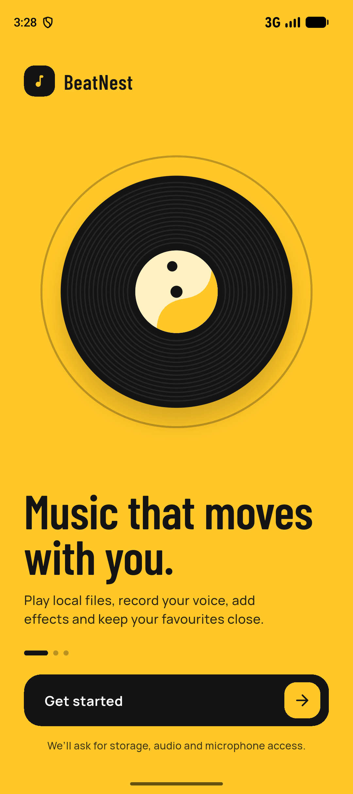
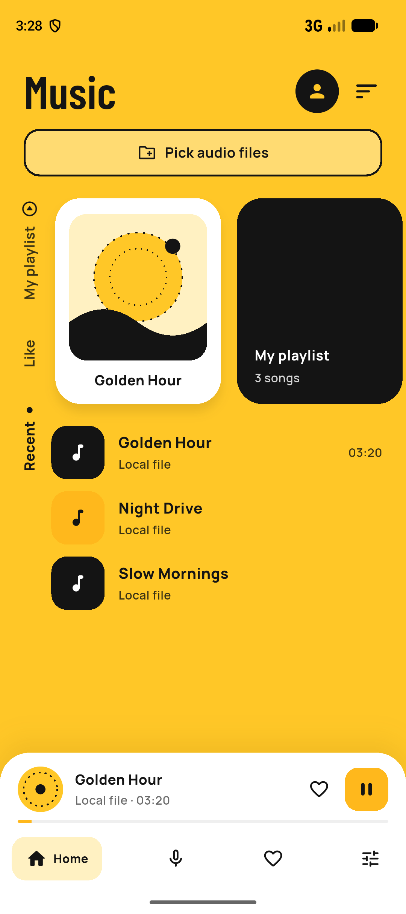
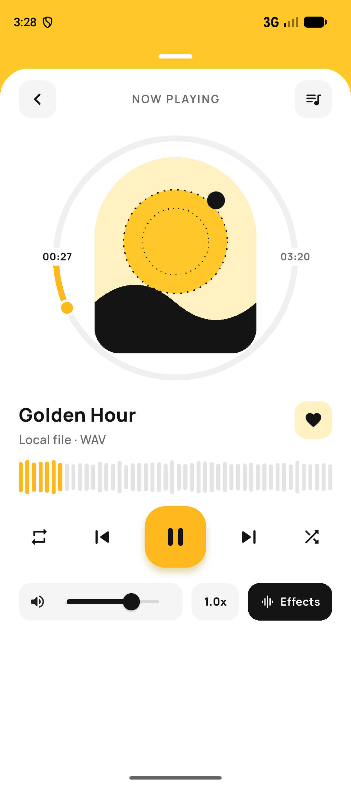
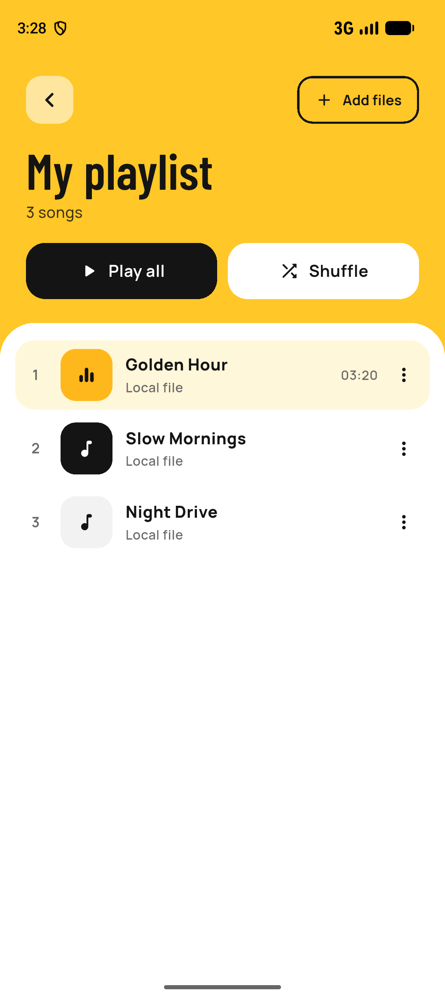
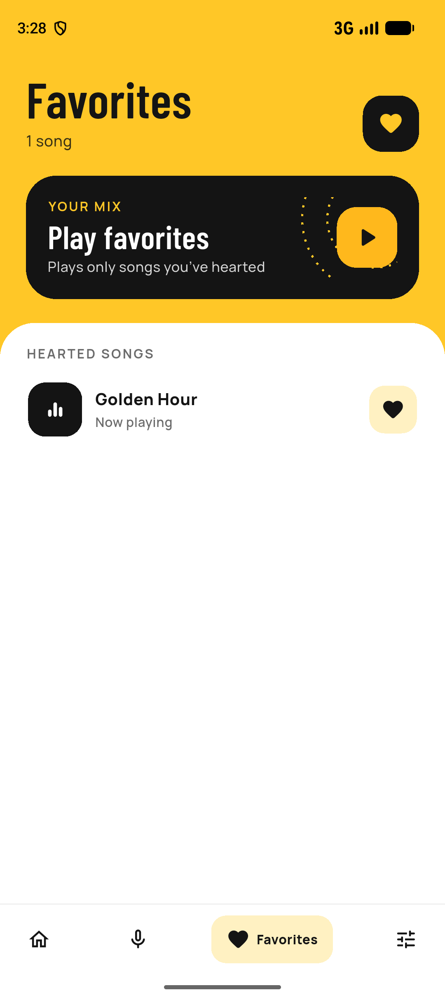
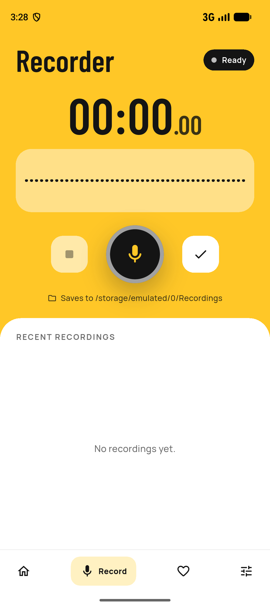
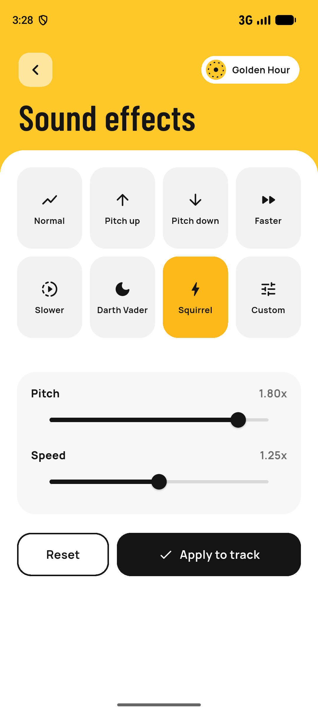
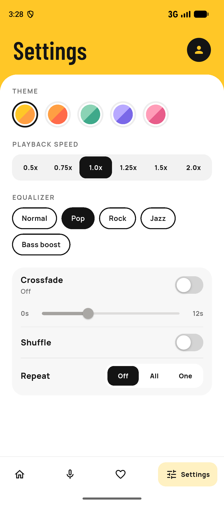
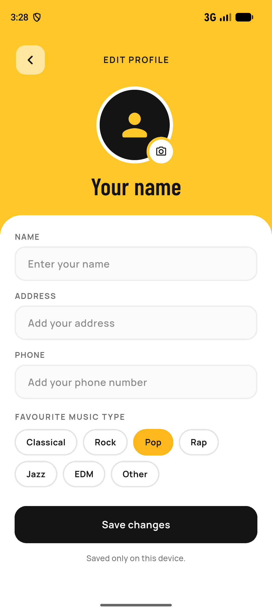
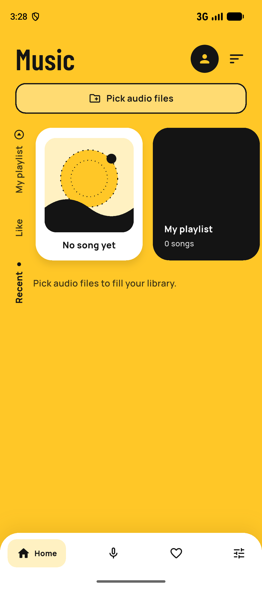

# 🎵 BeatNest

BeatNest is a cross-platform audio player built with Flutter. Play local audio files, record your voice, apply pitch and speed effects, keep a list of favourites and pick a colour theme, on Android and iOS.

## Screenshots

<table>
  <tr>
    <td align="center"><br><sub><b>Welcome</b></sub></td>
    <td align="center"><br><sub><b>Home</b></sub></td>
    <td align="center"><br><sub><b>Now playing</b></sub></td>
    <td align="center"><br><sub><b>Playlist</b></sub></td>
  </tr>
  <tr>
    <td align="center"><br><sub><b>Favorites</b></sub></td>
    <td align="center"><br><sub><b>Recorder</b></sub></td>
    <td align="center"><br><sub><b>Sound effects</b></sub></td>
    <td align="center"><br><sub><b>Settings</b></sub></td>
  </tr>
  <tr>
    <td align="center"><br><sub><b>Profile</b></sub></td>
    <td align="center"><br><sub><b>Empty library</b></sub></td>
    <td></td>
    <td></td>
  </tr>
</table>

## Features

### 🎧 Playback
- Play, pause, previous / next and seek by dragging around the artwork ring.
- Volume control and quick playback-speed switch on the Now Playing screen.
- Shuffle and repeat (off / all / one), with automatic advance to the next song.
- Waveform bars for the current song, plus a mini player on the Home screen.

### 📂 Library and playlist
- Pick several audio files at once; recently played songs appear on Home.
- **My playlist** screen with *Play all*, *Shuffle*, and a per-song menu (favourite, remove).

### ❤️ Favorites
- Heart any song from the mini player, Now Playing or the playlist.
- *Play favorites* plays only the songs you have hearted.

### 🎤 Recorder
- Record, pause, resume, save or discard, with a live level meter and timer.
- Saved recordings are listed on the same screen and can be played back there.
- Saved to `/storage/emulated/0/Recordings` on Android (the app documents folder on iOS).

### 🎛 Sound effects
- Presets: Normal, Pitch up / down, Faster, Slower, Darth Vader, Squirrel, or Custom.
- Pitch and speed sliders (0.5x–2.0x). Changes are heard live; *Apply to track* keeps them, leaving the screen otherwise restores the previous sound.

### ⚙️ Settings
- Five colour themes (Sunshine, Tangerine, Mint, Lilac, Rose), remembered between launches.
- Playback speed (0.5x–2.0x), repeat and shuffle.
- Equalizer preset and crossfade options (stored as settings; not yet applied to the audio).

### 👤 Profile
- Name, address, phone, favourite music type and profile photo, stored on the device with `shared_preferences`.

## Getting started

**Requirements**
- Flutter SDK 3.8+ (Dart `^3.8.1`)
- Android Studio or VS Code
- A device or emulator (the app asks for storage / audio and microphone permissions)

**Install and run**

```bash
git clone https://github.com/DuminduMalinga/Audio_player.git
cd Audio_player
flutter pub get
flutter run
```

The app uses [Google Fonts](https://pub.dev/packages/google_fonts) (Barlow Condensed and Manrope), which are downloaded on first use. Without a network connection it falls back to the system font.

## Usage

1. Tap **Get started** on the welcome screen.
2. On **Home**, tap **Pick audio files** and choose one or more songs. The first one starts playing.
3. Tap the mini player or any song to open **Now playing**: seek, change volume, shuffle, repeat and open **Effects**.
4. Use the heart to add songs to **Favorites**, and **My playlist** to see everything you added.
5. Open **Record** in the bottom bar to record, pause, save or discard a voice recording.
6. Open **Settings** to change theme, speed, repeat and shuffle, and tap the avatar to edit your **Profile**.

## Project structure

```
lib/
├── main.dart                     App entry, providers, global theme
├── services/
│   ├── player_service.dart       Shared audio player: queue, favourites, shuffle/repeat, effects
│   └── profile_provider.dart     Saved profile data
├── widgets/
│   └── common.dart               Shared UI: sheets, buttons, artwork, waveform, bottom nav, switches
└── screens/
    ├── welcome_screen.dart       Animated welcome screen
    ├── main_shell.dart           Bottom navigation + mini player
    ├── home_screen.dart          Library and recent songs
    ├── now_playing_screen.dart   Full player with progress ring
    ├── playlist_screen.dart      Playlist
    ├── favorites_screen.dart     Favourites
    ├── recording_screen.dart     Recorder and saved recordings
    ├── sound_effects.dart        Pitch / speed effects
    ├── settings_screen.dart      Theme and playback options
    ├── profile.dart              Edit profile
    └── theme_provide.dart        Colour palettes, text styles, theme state
```

## Main dependencies

| Package | Used for |
| --- | --- |
| `just_audio` | Playback, speed and pitch |
| `flutter_sound`, `audio_session` | Recording and recording playback |
| `audio_waveforms` | Extracting waveform data |
| `provider` | State management |
| `file_picker`, `image_picker` | Choosing audio files and a profile photo |
| `permission_handler`, `device_info_plus` | Storage, audio and microphone permissions |
| `shared_preferences` | Saving theme and profile |
| `google_fonts` | Barlow Condensed and Manrope |

## Acknowledgments

- Built with [Flutter](https://flutter.dev)
- Audio: [just_audio](https://pub.dev/packages/just_audio) and [flutter_sound](https://pub.dev/packages/flutter_sound)
- Waveforms: [audio_waveforms](https://pub.dev/packages/audio_waveforms)
- Thanks to the Flutter community for the open-source packages.
